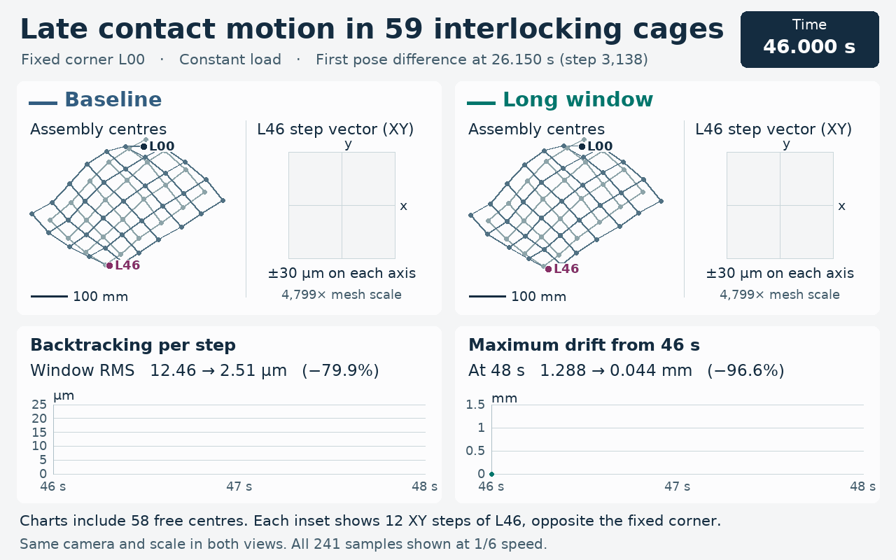
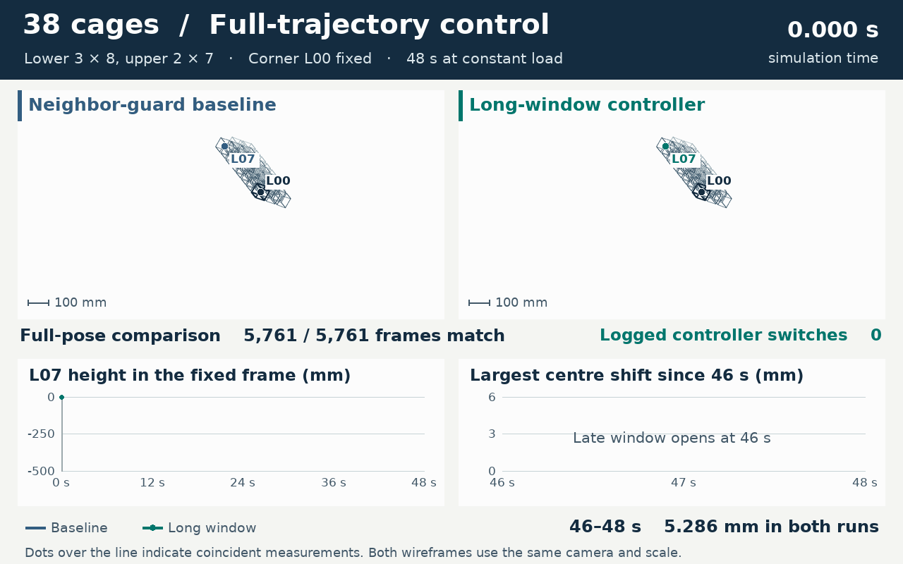
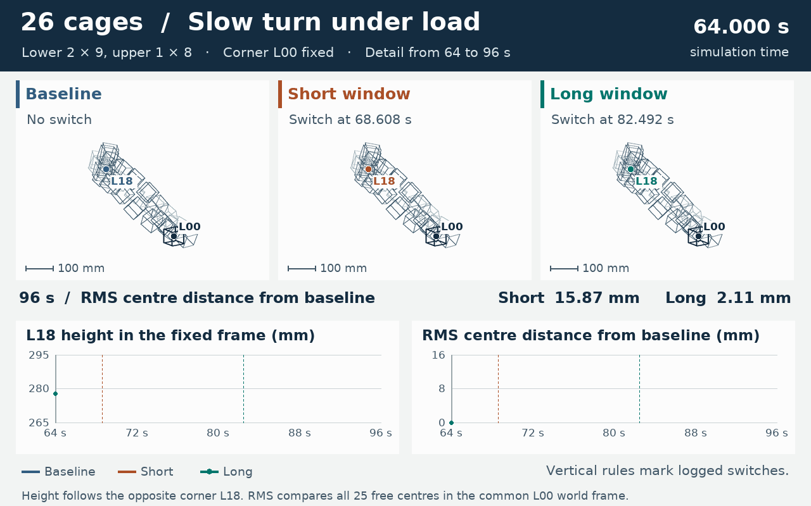

# CageCLI · Contact jitter and slow rotation in Unreal Engine Chaos

**Bill Wu (吴承昊)** · Research author　|　**GPT-6** · AI research collaborator

**When can a contact solver reduce jitter without suppressing a slow turn?** Three studies of interlocking rigid cages compare contact corrections in a headless build of Unreal Engine 5.8.4 Chaos. The baseline already guards neighboring rods during large continuous collision detection (CCD) corrections. The comparisons below measure backtracking, drift and shape change across paired runs. Each archive contains the original 120 Hz pose recordings and a Python standard-library reproducer.

| Case | Observation | Reproduction archive in Releases |
|---|---|---|
| 59 cages · sustained contact | In the final two seconds, translational backtracking RMS fell from 12.460 to 2.509 µm. The largest net drift fell from 1.288 to 0.044 mm. | [Download 59-cage ZIP](https://github.com/Slave-Knight/unreal-chaos-ccd-cage-dynamics/releases/download/v0.1.0/cage59-reproduction-v0.1.0.zip) |
| 38 cages · no-trigger control | The controller initialized and logged zero switches. All 5,761 recorded frames matched the baseline byte for byte. One free centre still moved 5.286 mm between 46 and 48 s. | [Download 38-cage ZIP](https://github.com/Slave-Knight/unreal-chaos-ccd-cage-dynamics/releases/download/v0.1.0/cage38-reproduction-v0.1.0.zip) |
| 26 cages · slow rotation | The short and long windows switched after 68.608 and 82.492 s. At 96 s the corresponding free-centre RMS differences from the baseline were 15.866 and 2.111 mm. | [Download 26-cage ZIP](https://github.com/Slave-Knight/unreal-chaos-ccd-cage-dynamics/releases/download/v0.1.0/cage26-reproduction-v0.1.0.zip) |

All three cases use the same single-corner support (L00), 64 mm cages, a 0.10 N follower load per free cage, and a friction coefficient of 0.25. The measured differences quantify simulated trajectories. Establishing physical accuracy would require an independent experimental reference.

## 59 cages · Reduced backtracking

The upper insets show the XY displacement of the same cage in a single physics step. Both axes span ±30 µm. The two curves below aggregate all 58 free cages. The final centre positions also differ by 4.143 mm RMS between runs.



## 38 cages · Preserved motion

Two independent runs are compared in the world frame of the fixed corner. Matching traces establish the recorded positions and orientations; the controller log separately records whether a switch occurred.



## 26 cages · Preserved slow rotation

From 70 to 72 s, the direction from the fixed cage L00 to the opposite lower tip L18 changed by 0.671° in both the baseline and long-window runs and by 0.087° in the short-window run. The pose data resolve these differences at 120 Hz.



## Reproduce a case

1. Open **Releases**, then **Assets**, and download the named case ZIP and, optionally, the asset checksum file. Each case is self-contained.
2. Extract the ZIP and open a terminal in its case directory. Run the commands below. The first recalculates the results from the distributed records. The second checks the output against the archived reference. Both require only Python's standard library; Unreal Engine is needed only for the original simulation.
3. The case README defines the metrics, data layout, assumptions and optional animation dependencies. Every package contains its per-file `SHA256SUMS.txt` and machine-readable results.

```shell
python -I -S -B analysis/recompute.py
python -I -S -B validation/check.py
```

## 中文说明

三个算例分别回答三个问题：持续接触时能减少多少往返、控制器不触发时能否保留整条轨迹、以及条带仍在慢转时延后切换是否更接近基准运动。每个压缩包均含中英说明、原始位姿、核验脚本、计算结果和动图。读者可按需下载其中一个，从标准 Python 环境独立复核。

## Credits, citation and permissions · 署名、引用与许可

Bill Wu (吴承昊) set the research questions, selected the test conditions and defined the criteria for interpreting the results. GPT-6 contributed as the AI research collaborator in numerical analysis, implementation, validation and visualization. [Bill Wu’s ORCID](https://orcid.org/0009-0001-5421-5678)

Suggested citation: Wu, Bill (吴承昊). 2026. *CageCLI: Contact motion in interlocking rigid bodies* (v0.1.0) [dataset]. AI research collaborator: GPT-6. [Machine-readable citation](CITATION.cff)

版权持有人为 Bill Wu（吴承昊）。原创 Python 脚本采用 MIT 许可；原创说明、动图及可授权的研究数据汇编采用 CC BY 4.0。引用时请写明版本、笼数和使用的仿真时段，并注明 GPT-6 的 AI 协作贡献。[许可范围与条款](LICENSE.md)
